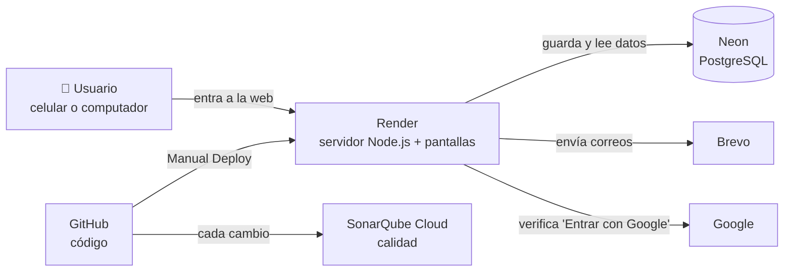

# VitalTraining por dentro

Dónde vive la app, dónde se guardan los datos y qué servicio hace cada cosa.

**App publicada:** https://vitaltraining-pro.onrender.com

> Versión con diseño para proyectar: descarga [`arquitectura.html`](arquitectura.html) (botón **Download raw file**) y ábrela en el navegador.

## Paneles para abrir en clase

| Panel | Para qué | Enlace |
|---|---|---|
| **La app** | Lo que ven los usuarios | https://vitaltraining-pro.onrender.com |
| **Render** | Servidor, deploys y logs | https://dashboard.render.com |
| **Neon** | Base de datos y tablas | https://console.neon.tech |
| **GitHub** | Código, historial y CI | https://github.com/TUNEGRITOPRIPRATRULULOCORO-glitch/VITALTRAINING-PRO- |
| **SonarQube** | Calidad del código (Passed, todo en A) | https://sonarcloud.io/project/overview?id=TUNEGRITOPRIPRATRULULOCORO-glitch_VITALTRAINING-PRO |
| **Brevo** | Correos enviados | https://app.brevo.com |

## El mapa

La persona abre la dirección de la app. Render le entrega las pantallas y ejecuta el servidor; cuando hay que guardar o leer datos, el servidor se los pide a Neon.



## Qué hace cada servicio

### Render: donde vive la app
- Ejecuta el servidor y entrega las pantallas (HTML, CSS y JS).
- Construye la app con el `Dockerfile` a partir de GitHub, rama `main`.
- Después de subir cambios: **Manual Deploy → Deploy latest commit**.
- No guarda archivos de forma permanente; por eso los datos van en Neon.

### Neon: la base de datos (PostgreSQL)
- **La única base de la app publicada**: usuarios, perfiles, salud, comidas, rutinas, tests físicos, mensajes, tickets, fotos de perfil y conversaciones con el asistente.
- Está aparte de Render: los datos sobreviven a reinicios y deploys.
- Las contraseñas se guardan cifradas (bcrypt), nunca en texto.
- En **Tables** se ve cada tabla con sus filas.

### GitHub: el código
- Cada cambio queda guardado con su explicación.
- El CI pasa los 329 tests y construye la imagen de Docker en cada subida.

### SonarQube Cloud: calidad del código
- Analiza solo cada cambio: fallos probables, seguridad y mantenibilidad.
- **Quality Gate: Passed.** Fiabilidad, seguridad y mantenibilidad en **A**; 0 bugs, 0 vulnerabilidades, 0 code smells.

### Brevo: correos
- Bienvenida, recuperar contraseña y alertas de salud y de carga. Plan gratis: 300 correos al día.

### Google Cloud: "Entrar con Google"
- Solo pide nombre y correo. Requiere la página de privacidad publicada en la app.

### Claude: asistente "Vita" (sin activar)
- Con una clave de pago conversaría usando los datos del atleta. Sin clave responde con los análisis propios de la app (modo básico, gratis).

## ¿Cuántas bases de datos hay?

Una sola de verdad: **Neon**. Las otras sirven para probar sin tocar los datos reales; por eso en el computador se ven usuarios distintos a los de la web.

| Dónde corre la app | Base de datos | Para qué |
|---|---|---|
| **La web (Render)** | **Neon** | **La app real, con usuarios reales** |
| Tu computador (`localhost:4000`) | PGlite, en `base-de-datos/datos-locales/` | Probar cambios sin riesgo |
| Los tests | pg-mem, en memoria | Se crea y se borra en cada prueba |
| Docker (opcional) | PostgreSQL en un contenedor | Probar igual que en producción |

## La configuración secreta

Vive en Render, en el grupo de variables **Pro**. El código nunca lleva estos valores, solo sus nombres.

| Variable | Qué guarda |
|---|---|
| `DATABASE_URL` | Dirección y contraseña de la base de Neon |
| `JWT_SECRET` | Clave con la que se firman las sesiones |
| `ADMIN_PASSWORD` | Contraseña del admin al crear la base por primera vez |
| `DATOS_DEMO` | `false`: no crear cuentas de prueba |
| `BREVO_API_KEY`, `CORREO_REMITENTE` | Enviar correos con Brevo |
| `GOOGLE_CLIENT_ID` | Botón "Entrar con Google" (este no es secreto) |

## Cómo llega un cambio a la web

1. **Se cambia el código** y se prueba en el computador, con la base local.
2. **Se sube a GitHub** (rama `main`). El CI pasa los tests y SonarQube analiza.
3. **Manual Deploy en Render.** Render construye la imagen con Docker y publica la nueva versión.
4. **Neon no se toca.** Los usuarios y sus datos siguen ahí.

## Límites del plan gratis

| Servicio | Límite | Qué significa en la práctica |
|---|---|---|
| Render | Se duerme a los 15 min sin visitas | La primera visita tarda cerca de 1 minuto. Ábrela antes de clase. |
| Neon | 0,5 GB de espacio | Sobra para un club: una foto de perfil ocupa unos 50 KB. |
| Neon | Se apaga cuando no se usa | Despierta en menos de un segundo. |
| Brevo | 300 correos al día | Suficiente para registros y alertas. |
| SonarQube Cloud | Gratis en repositorios públicos | El análisis automático no muestra la cobertura de tests. |

## Preparar la laptop

Todo está en internet: en la laptop solo hace falta iniciar sesión en cada panel.

- [ ] Entrar en **Render** (dashboard.render.com) con la misma cuenta del PC.
- [ ] Entrar en **Neon** (console.neon.tech) con la misma cuenta. Si entraste con Google o GitHub, usa ese botón.
- [ ] Entrar en **GitHub**, para mostrar el código, los cambios y el CI en verde.
- [ ] Entrar en **SonarQube Cloud** (sonarcloud.io → Log in → With GitHub).
- [ ] Probar la app con tu admin de la web (no es `admin123`: esa es la del PC).
- [ ] Abrir la app 2 minutos antes de presentar, para que Render ya esté despierto.

**Opcional, el código en la laptop** (para mostrar la app corriendo en local; necesitas Git y Node.js 20 o más nuevo):

```bash
git clone https://github.com/TUNEGRITOPRIPRATRULULOCORO-glitch/VITALTRAINING-PRO-.git
cd VITALTRAINING-PRO-
npm install
npm start
# Abre http://localhost:4000 · admin@vital.com / admin123 (base local nueva, con datos de prueba)
```

## Guion para la demo

1. **La app.** Portada, registro y un atleta: plan, salud y asistente.
2. **Render.** El servicio en línea, el historial de deploys y los Logs ("Base de datos lista · postgresql").
3. **Neon.** Tables → `usuarios` o `salud`: los datos que se acaban de ver en la app. Las contraseñas aparecen cifradas.
4. **GitHub.** El historial de cambios y Actions con el CI en verde.
5. **SonarQube.** Quality Gate Passed y las notas en A.

## ⚠️ Cuidado al proyectar

- No muestres la **connection string** de Neon ni las variables de Render con su valor visible: dan acceso a todos los datos.
- En Neon, enseña las tablas sin abrir datos personales de usuarios reales, o muéstralos rápido.
- No dejes la sesión de Render o Neon abierta en un computador de la universidad.
